<a href="https://qodrasystems.com/en/card/a.ayyash" target="_blank">
  <picture>
    <source media="(prefers-color-scheme: dark)" srcset="./assets/hero-dark.svg?v=3">
    <source media="(prefers-color-scheme: light)" srcset="./assets/hero-light.svg?v=3">
    
  </picture>
</a>

 

  <a href="https://qodrasystems.com/en/card/a.ayyash" target="_blank"><picture><source media="(prefers-color-scheme: dark)" srcset="./assets/btn-card-dark.svg?v=4"><source media="(prefers-color-scheme: light)" srcset="./assets/btn-card-light.svg?v=4"></picture></a>&nbsp;
  <a href="https://github.com/qodrasystems"><picture><source media="(prefers-color-scheme: dark)" srcset="./assets/btn-org-dark.svg?v=4"><source media="(prefers-color-scheme: light)" srcset="./assets/btn-org-light.svg?v=4"></picture></a>&nbsp;
  <a href="mailto:a.ayyash@qodrasystems.com"><picture><source media="(prefers-color-scheme: dark)" srcset="./assets/btn-email-dark.svg?v=4"><source media="(prefers-color-scheme: light)" srcset="./assets/btn-email-light.svg?v=4"></picture></a>&nbsp;
  <a href="https://wa.me/962787679639" target="_blank"><picture><source media="(prefers-color-scheme: dark)" srcset="./assets/btn-whatsapp-dark.svg?v=4"><source media="(prefers-color-scheme: light)" srcset="./assets/btn-whatsapp-light.svg?v=4"></picture></a>

---

### About & Current Focus

I'm **Abd-Alrahman Ayyash** — Founder, CEO, and hands-on Systems Architect at **[Qodra Systems](https://github.com/qodrasystems)** in Amman, Jordan. Since 2018, I've focused on building mission-critical operational software where database integrity, real-time performance, and clean UX directly power daily business execution.

- **Single-Database ERP Core ([Qodra OS](https://qodrasystems.com/en/systems/erp.html)):** Architecting transactional `PL/pgSQL` financial ledgers, multi-branch inventory, POS, HR/payroll, and MENA e-invoicing where a single sale reconciles stock, accounting, and dashboards in real time.
- **Governed Enterprise AI ([Awni](https://qodrasystems.com/en/systems/ai.html)):** Designing role-scoped Arabic & voice AI agents that execute real operational workflows with strict RBAC boundaries, audit trails, and human-in-the-loop approval.
- **Spatial & Cross-Platform Systems ([Indoor Navigation](https://qodrasystems.com/en/systems/navigation.html)):** Engineering GPS-free cross-floor wayfinding, live venue heatmaps, and high-throughput `Flutter` & web platforms.
- **Building at [`@qodrasystems`](https://github.com/qodrasystems):** Looking for the full 12-module Qodra OS suite, sector systems, or enterprise inquiries? Visit **[`github.com/qodrasystems`](https://github.com/qodrasystems)** or **[qodrasystems.com](https://qodrasystems.com/en/)**.

---

  <picture>
    <source media="(prefers-color-scheme: dark)" srcset="./assets/telemetry-dark.svg">
    <source media="(prefers-color-scheme: light)" srcset="./assets/telemetry-light.svg">
    
  </picture>

  <picture>
    <source media="(prefers-color-scheme: dark)" srcset="./assets/stack-dark.svg?v=3">
    <source media="(prefers-color-scheme: light)" srcset="./assets/stack-light.svg?v=3">
    
  </picture>

---

  <strong>عبدالرحمن عياش</strong> · المؤسس والمدير التنفيذي — <strong>شركة قدرة للأنظمة</strong> · عمّان، الأردن

  
    <a href="https://github.com/qodrasystems"><strong>@qodrasystems</strong></a>
    &nbsp;·&nbsp;
    <a href="https://qodrasystems.com/en/card/a.ayyash">Digital Card (EN)</a>
    &nbsp;·&nbsp;
    <a href="https://qodrasystems.com/card/a.ayyash">Digital Card (AR)</a>
    &nbsp;·&nbsp;
    <a href="https://qodrasystems.com/en/">qodrasystems.com</a>
    &nbsp;·&nbsp;
    <a href="mailto:a.ayyash@qodrasystems.com">a.ayyash@qodrasystems.com</a>
  

